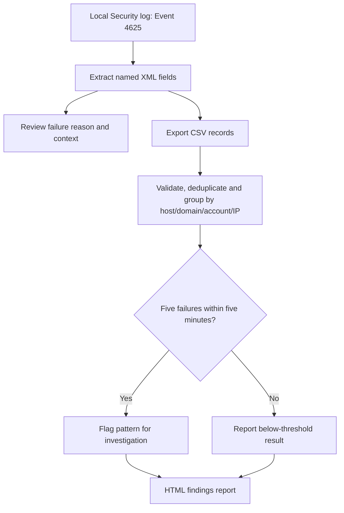
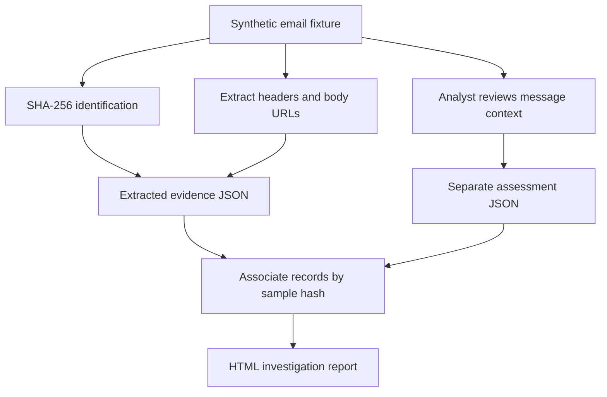

# SOC Investigation & Detection Portfolio
**Santhosh Banoth | SOC Analyst**

Practical security investigations supported by evidence, reproducible PowerShell tools, analyst reports, and automated Windows tests.

[](https://github.com/Banoth281/soc-login-lab/actions/workflows/powershell-tests.yml)
[](https://github.com/Banoth281/soc-login-lab/actions/workflows/phishing-tests.yml)

[GitHub profile](https://github.com/Banoth281) · [LinkedIn](https://www.linkedin.com/in/banoth281/)

## Recruiter overview

| Project | Security question | Demonstrated work | Case study |
|---|---|---|---|
| Windows authentication investigation | Why did a logon fail, and when should repeated failures be flagged? | Event 4625 analysis, XML extraction, rolling-window detection, CSV/HTML reporting, automated tests | [Windows case study](windows-event-investigation/CASE-STUDY.md) |
| Phishing email investigation | What evidence supports a credential-phishing assessment? | Sample hashing, header and URL extraction, separate analyst judgment, JSON/HTML reporting, automated tests | [Phishing case study](phishing-email-investigation/CASE-STUDY.md) |
| Python authentication exercise | Which accounts have repeated failures followed by a success? | Synthetic CSV analysis, grouped detection, investigation notes | [Python script](detect_logins.py) · [Notes](investigation_notes.txt) |

**Suggested review:** read either case study, inspect its evidence, then open the linked test run. Professional experience is described on my profile; the projects here are personal lab exercises.

## Verified results

| Area | Observed outcome | Evidence |
|---|---|---|
| Windows collection | Two actual test-account failed-logon records read from the local Security log | [Event evidence](windows-event-investigation/evidence/05-controlled-logon-result.txt) · [Validation](windows-event-investigation/powershell/README.md) |
| Windows detection | Zero alerts for two events, correctly below the five-event threshold | [Packaged-script verification](windows-event-investigation/powershell/README.md#packaged-script-verification) |
| Windows automated tests | V2: 30/30 initial checks passed locally; 31/31 hosted checks passed after the path fix | [Test code](windows-event-investigation/powershell/Test-RepeatedFailures.ps1) · [Latest regression run](https://github.com/Banoth281/soc-login-lab/actions/runs/39119036887) |
| Windows reporting | V2 HTML: 2 imported, 2 unique, 0 duplicates, 0 alerts; CSV/HTML hashes matched local manifest | [Report validation](windows-event-investigation/powershell/README.md#html-report) |
| Phishing evidence | Original sample hash independently verified; five submitted files matched ZIP entries | [Validation record](phishing-email-investigation/VALIDATION.md) |
| Phishing automated tests | Ten extraction checks passed on a hosted Windows runner | [Test code](phishing-email-investigation/Test-LabEmail.ps1) · [CI run](https://github.com/Banoth281/soc-login-lab/actions/runs/39115587909) |
| Phishing reporting | HTML generation and encoding checks passed; user supplied generated report content | [Report test](phishing-email-investigation/Test-PhishingReport.ps1) · [CI run](https://github.com/Banoth281/soc-login-lab/actions/runs/39115864024) |

Local Windows execution evidence comes from supplied console transcripts, event text/XML, and screenshots. Hosted CI results are separately linked. The original Windows EVTX was not supplied. Phishing HTML content is verified; browser visual layout has not been reviewed from a screenshot.

## 1. Windows authentication investigation

### Investigation and detection workflow



### Findings

- Event **4625**, record **1832673**, at **2026-10-18T08:18:19.3299718Z**.
- Logon Type **3** and source **127.0.0.1** are consistent with the authorised local network test.
- Status **0xC000006D** indicates authentication failure; substatus **0xC0000064** narrows it to an unrecognised username.
- PowerShell collected two test-account events. Neither the actual dataset nor this lab demonstrates a live above-threshold attack.

### Rule and testing

The detector flags at least five failures for the same destination host/domain/account/source group within an **inclusive five-minute rolling window**. It emits at most one alert per pair per invocation.

Thirty-one v2 regression checks retain the original threshold and boundary checks and add domain/host isolation, event identity deduplication, strict input rejection, timezone/IPv6 normalisation, and report integration. [Migration instructions](windows-event-investigation/powershell/README.md#migration-from-the-old-csv) explain why old CSVs must be recollected with the upgraded reader. Historical actual-event results are preserved separately from synthetic v2 tests.

[Investigation guide](windows-event-investigation/README.md) · [PowerShell tools](windows-event-investigation/powershell/README.md) · [Case study](windows-event-investigation/CASE-STUDY.md)

## 2. Phishing email investigation

### Evidence and assessment workflow



### Findings

The fixture asks the recipient to disclose a username and password, threatens account disablement, and uses different sender, reply, and link domains. The explicit credential request supports the analyst's training-scenario verdict; domain differences alone are insufficient.

The extractor leaves the verdict for analyst review. Embedded SPF, DKIM, and DMARC values are **synthetic, unverified header text**.

### Evidence handling and reporting

- Exact original sample bytes and SHA-256 retained.
- Extracted evidence and analyst assessment stored separately.
- Report input is HTML-encoded; URLs appear as text rather than links.
- Automated tests use temporary folders and do not overwrite original evidence.
- No network requests, live email delivery, or containment actions are involved.

[Project guide](phishing-email-investigation/README.md) · [Original sample](phishing-email-investigation/sample-phishing.eml) · [Analyst report](phishing-email-investigation/investigation-report.md) · [Case study](phishing-email-investigation/CASE-STUDY.md)

## Local v2 verification
The upgraded collector and corrected report generator ran successfully on the user's Windows computer. The CSV and HTML matched their recorded SHA-256 hashes. [Validation and integrity record](windows-event-investigation/evidence/LOCAL-V2-VALIDATION.md) includes the reported results; raw files remain local. Local tests: 30 original v2 cases. Hosted tests: 31 cases including the path fix.

## Skills demonstrated

| Skill | Where to review it |
|---|---|
| Windows log investigation | Event status/substatus, logon type, UTC timestamp, and record-ID analysis |
| Detection engineering | Rolling-window logic, grouping, thresholds, and boundary tests |
| Email analysis | Header inspection, sample hashing, URL extraction, and evidence-based verdict |
| PowerShell automation | Reusable collection, parsing, detection, and reporting scripts |
| Testing and CI | Assertions, malformed-input rejection, and GitHub-hosted Windows jobs |
| Investigation documentation | Sanitised evidence, provenance, findings, proposed actions, and limitations |

## Run the projects

### Windows tools

From the PowerShell tools folder:
```powershell
Set-Location './windows-event-investigation/powershell'
./Test-RepeatedFailures.ps1
```

Reading the live Security log requires appropriate privileges. Full collection and reporting instructions are in the [Windows tools guide](windows-event-investigation/powershell/README.md).

### Phishing tools

From the repository root:
```powershell
Set-Location './phishing-email-investigation'
./Test-LabEmail.ps1
./Test-PhishingReport.ps1
./New-PhishingReport.ps1
Invoke-Item './phishing-report.html'
```

No administrator access is needed for the synthetic phishing tests. The extractor overwrites its extracted-evidence.json output; the report generator writes phishing-report.html. Review scripts and follow applicable execution policies.

### Original Python exercise

From the repository root:
```shell
python detect_logins.py
```

Uses the Python standard library and synthetic login_logs.csv. Each run replaces alerts.csv. The documented fixture yields two alerts, for charlie and diana, each following five failures and a success within 2 minutes 30 seconds. Follow-up scenarios in investigation_notes.txt are fictional context, not facts in the CSV.

## Repository guide

| Location | Contents |
|---|---|
| [windows-event-investigation](windows-event-investigation/README.md) | Windows case study, sanitised evidence, scripts, reports, and test history |
| [phishing-email-investigation](phishing-email-investigation/README.md) | Original synthetic email, extractor, JSON evidence, reports, and tests |
| [.github/workflows](.github/workflows) | Windows detector and phishing test workflows |
| [detect_logins.py](detect_logins.py) | Original synthetic authentication exercise |
| [investigation_notes.txt](investigation_notes.txt) | Python exercise investigation notes and proposed responses |

## Scope and limitations

These are controlled personal labs. Actual Windows records, synthetic fixtures, analyst conclusions, and proposed responses are identified separately. No production SIEM deployment, confirmed intrusion, or real containment is claimed.

The Windows v2 detector validates records and separates host/domain context, with identity-based deduplication. Unknown domain values remain ambiguous, and there is no persistent alert suppression. It requires the v2 collector schema. It is not a multi-account password spray detector. The email extractor is a simple plain-text parser, not a general MIME library; it does not perform attachment analysis, reputation checks, or authentication verification. The HTML report associates JSON records by their recorded hash rather than independently rehashing the source email.

Future improvements include domain/host-aware grouping, stronger input validation, broader email fixtures, and robust MIME parsing.
