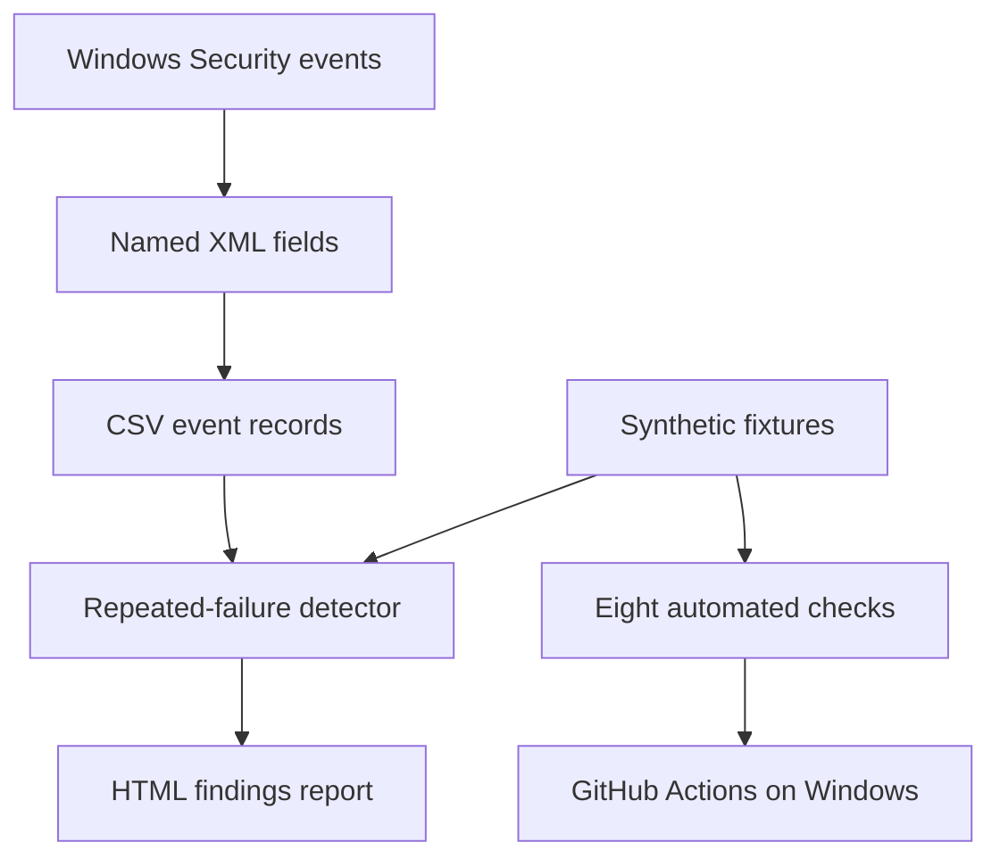

# SOC Authentication Investigation Lab

[](https://github.com/Banoth281/soc-login-lab/actions/workflows/powershell-tests.yml)

**Windows event investigation, PowerShell detection, automated tests, and HTML reporting.**

A local SOC portfolio project by **Santhosh Banoth**. Analyse failed authentication events, explain their cause, and validate a repeated-failure detector with reproducible synthetic checks.

## Start here
- **[Read the case study](windows-event-investigation/CASE-STUDY.md)** — problem, investigation, outcomes, and limitations
- **[Explore the Windows investigation](windows-event-investigation/README.md)** — commands and sanitised evidence
- **[Run the PowerShell tools](windows-event-investigation/powershell/README.md)** — collection, detection, tests, and reports

## Workflow


## Verified outcomes
| Component | Result | Evidence |
|---|---|---|
| Windows event collection | Two test-account failures read | [Event evidence](windows-event-investigation/evidence/05-controlled-logon-result.txt) and [validation notes](windows-event-investigation/powershell/README.md) |
| Actual-data analysis | Zero alerts; two events are below the threshold of five | [PowerShell validation](windows-event-investigation/powershell/README.md) |
| Automated synthetic tests | 8/8 passed on Windows | [Test suite](windows-event-investigation/powershell/Test-RepeatedFailures.ps1) |
| Continuous integration | First Windows test job succeeded | [Successful run](https://github.com/Banoth281/soc-login-lab/actions/runs/39113190608) |
| Reporting | CSV reimport and HTML display confirmed | [Report documentation](windows-event-investigation/powershell/README.md#html-report) |

## Report contents
The locally generated HTML report displays imported-event and threshold-alert counts, a UTC event table, detection findings, and interpretation limits. The reviewed report showed **2 imported events and 0 threshold alerts**. Original screenshots are not published.

## Detection scope
The PowerShell rule detects **at least five failures for the same account and source IP within an inclusive five-minute window**. An alert is an investigation lead. The actual-data case remained below threshold; positive detections were validated with synthetic records.

The separate Python exercise below detects failures followed by a success using synthetic CSV data. Neither exercise claims production deployment or confirmed compromise.

---

## Original Python exercise: suspicious login sequences

A beginner SOC portfolio lab using Python to detect suspicious login sequences and document investigation decisions.

## Purpose

Detect five or more failed logins followed by a successful login for the same account and source IP within five minutes.

An alert indicates activity to investigate, not proof of compromise.

## Tools

- Python standard library
- CSV login records
- Windows Command Prompt

No additional Python packages are required.

## Files

- `login_logs.csv` — 15 synthetic login records
- `detect_logins.py` — detection script and CSV report export
- `alerts.csv` — generated alert report
- `investigation_notes.txt` — evidence, fictional follow-up scenarios and proposed responses

## Run

From the project folder:

```shell
python detect_logins.py
```

On Windows, you can also use:

```cmd
py detect_logins.py
```

Each run replaces `alerts.csv` with the latest results.

## Sample Results

The supplied dataset produces two alerts:

| Account | Failed attempts | Time until success |
|---------|-----------------|--------------------|
| charlie | 5 | 2 minutes 30 seconds |
| diana | 5 | 2 minutes 30 seconds |

Alice and Bob do not meet the alert threshold.

## Investigation Practice

Charlie's fictional follow-up scenario illustrates suspected account compromise and proposed escalation and containment.

Diana's fictional follow-up scenario illustrates likely benign activity and the importance of checking context.

Follow-up details are explicitly labelled as assumptions in the investigation notes. They are not contained in the CSV.

## Detection Behaviour

The script sorts events by timestamp and tracks failures separately for each account and source IP. Failures older than five minutes are excluded. A successful login resets that group's failure history.

## Limitations

- Uses synthetic data and documentation-only IP addresses.
- Not connected to a live identity system or SIEM.
- Does not detect password spraying or attacks across multiple IPs.
- Assumes valid CSV fields and timestamps.
- No real containment actions were performed.

## Skills Demonstrated

Log analysis, Python scripting, rule-based detection, CSV reporting, alert triage and investigation documentation.
